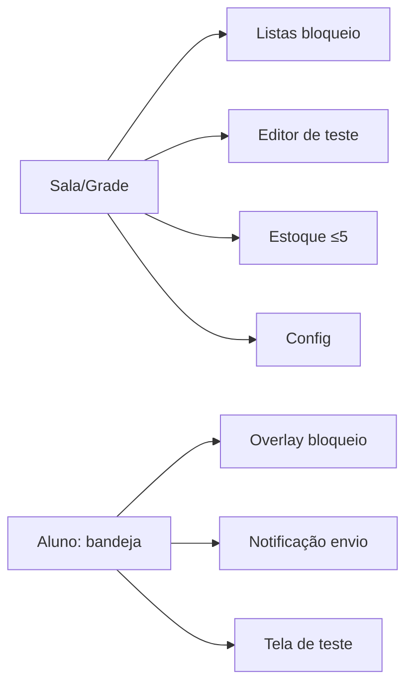
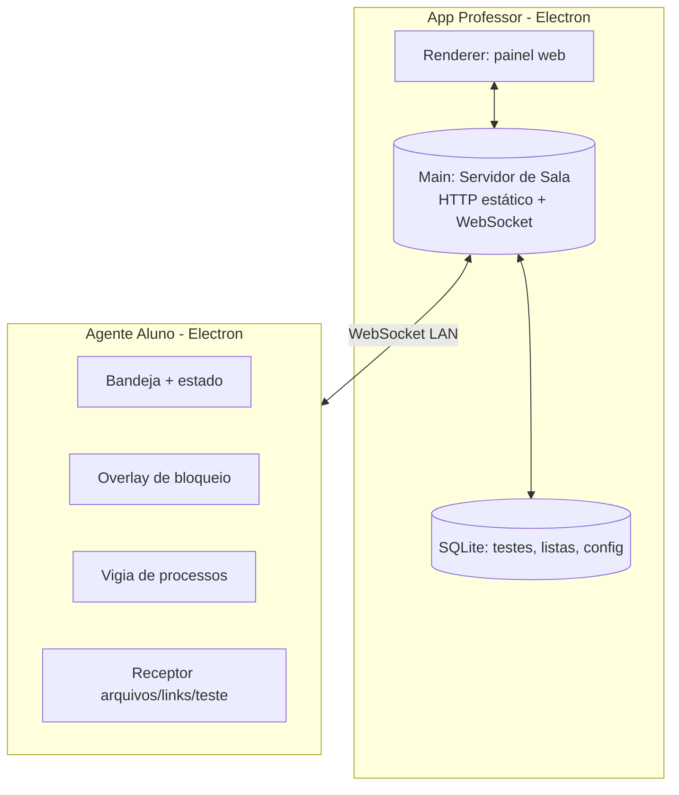

# AulaCerta — Especificação do Produto

> Sistema próprio e independente de gestão de sala de aula para Windows em rede local (LAN).
> Resolve as mesmas necessidades gerais de produtos como o NetSupport School, mas com
> arquitetura, fluxos, interface, nomenclatura, modelo de dados e APIs **próprios**, e
> código escrito do zero. Nome provisório: **AulaCerta** (troque à vontade).

Versão do documento: 0.1 · Data: 2026-10-19

---

## 0. Antes de qualquer código — pontos de risco de cópia (leia primeiro)

Esta seção existe para manter o projeto limpo de problemas legais. Regras firmes:

| Risco | Regra adotada no AulaCerta |
|---|---|
| **Cópia de código** | Nada de decompilar o NetSupport e portar lógica. Todo código é original (a Etapa 1 já foi assim). |
| **Protocolo proprietário** | Não reimplementar o protocolo de rede do NetSupport. Usamos WebSocket + JSON próprio (`shared/protocol.js`). |
| **Marca / identidade** | Nome, ícones, textos e paleta próprios. Não usar "NetSupport", "Tutor", "client32", nem logotipos/strings do produto. |
| **Reprodução de interface** | Não copiar telas, disposição de botões ou fluxos visuais do original. Layout desenhado do zero (ver Mapa de Telas). |
| **Dependência do binário original** | Zero. O AulaCerta não instala, chama, nem requer qualquer arquivo do NetSupport em produção. |
| **Nomenclatura** | Termos próprios em pt-BR: *Sala*, *Aluno*, *Professor*, *Bloqueio*, *Reservado*, *Envio*, *Teste*. |
| **Recursos sensíveis** | Nada de monitoramento oculto, evasão de antivírus ou persistência furtiva. Toda restrição é **sinalizada** ao aluno. |

**Premissa de uso legítimo:** máquinas geridas pela instituição, com o aluno ciente de que, durante a aula, a tela pode ser bloqueada e apps podem ser restritos. Fora disso, não se usa.

---

## 1. Visão do produto

Um professor controla, de forma simples e transparente, os computadores Windows de uma turma na mesma rede local: vê quem está conectado, bloqueia telas, restringe aplicativos e sites previamente definidos, envia arquivos e links para todos de uma vez, e aplica testes curtos. Sem nuvem, sem telemetria, sem anúncios. Instalação trivial: o app do professor **é** o servidor da sala; os alunos só apontam para o IP do professor.

**Princípios:** simplicidade acima de completude; transparência por padrão (o aluno sempre sabe quando está sob controle); privacidade local (dados não saem da LAN).

---

## 2. Mapa de funcionalidades (com decisão por item)

Legenda da decisão: **[1]** design próprio · **[2]** adaptar · **[3]** substituir por algo melhor · **[4]** adiar · **[5]** não implementar.

| # | Funcionalidade | Decisão | Nota |
|---|---|---|---|
| F1 | Descoberta/presença de alunos na sala | **[1]** | Entregue na Etapa 1. |
| F2 | Bloqueio de tela — modos **"Bloqueio"** e **"Reservado"** | **[1]** | Mesma função, dois rótulos configuráveis. Overlay visível. |
| F3 | Bloqueio/liberação de **apps predefinidos** | **[2]** | Lista que o professor define; encerra processo + aviso ao aluno. |
| F4 | Bloqueio de **web** | **[3]** | Em vez de hook de sistema, navegador gerenciado via proxy local de filtragem, só durante a aula. |
| F5 | **Envio para todos** — arquivos e links | **[1]** | Push por WebSocket; pasta conhecida + notificação; link abre no navegador. |
| F6 | **Testes/quiz** — ≤10 questões, objetiva/dissertativa, estoque ≤5 | **[1]** | SQLite local; limites validados no banco e na UI. |
| F7 | Monitoramento de miniaturas das telas | **[4]** | Adiado; quando entrar, será opt-in e sinalizado ao aluno. |
| F8 | Controle remoto do mouse/teclado do aluno | **[5]** | Não implementar nesta versão (risco e complexidade; fora do seu escopo). |
| F9 | Chat/mensagens | **[4]** | Adiado. |

---

## 3. Mapa de telas

**App do Professor** (desenho próprio, layout em painel único):

```
┌─ AulaCerta — Professor ─────────────────────────────┐
│ [Sala: 192.168.1.18]           ● sala no ar   [⚙]   │
├─────────────────────────────────────────────────────┤
│ Barra de ações:  [Bloqueio] [Reservado] [Liberar]    │
│                  [Bloquear apps] [Enviar ▾] [Teste ▾]│
├─────────────────────────────────────────────────────┤
│ Grade de alunos (cartões):                           │
│  ┌ Ana · PC-01 ● online ┐  ┌ Bruno · PC-02 ● ┐  ...  │
│  │ estado: Bloqueado     │  │ estado: Em aula │       │
│  └───────────────────────┘  └─────────────────┘       │
└─────────────────────────────────────────────────────┘
```

Telas/modais: **Sala** (grade), **Listas de bloqueio** (apps/sites), **Editor de teste** (até 10 questões), **Estoque de testes** (até 5), **Configurações** (rótulos dos modos, pasta de envio, porta).

**App do Aluno** (minimalista, pouco intrusivo):
- **Bandeja**: ícone + estado ("Em aula", "Bloqueado").
- **Overlay de bloqueio**: tela cheia com mensagem clara ("Aula em andamento — tela bloqueada pelo professor").
- **Notificação de envio**: "Você recebeu um arquivo/link".
- **Tela de teste**: questões uma a uma.



---

## 4. Arquitetura

Uma linguagem (**JavaScript/Node ESM**), empacotável em **Electron** para professor e aluno. O app do professor **hospeda** o servidor da sala; não há serviço separado para implantar.



**Camadas:** `shared/` (contrato de mensagens, tipos) · `src/` (servidor de sala, agente do aluno) · `professor/` (UI) · (futuro) `aluno/` (shell Electron com overlay e vigia). **Processos:** professor roda 1 servidor; N agentes conectam. **Comunicação:** WebSocket full-duplex para comandos/status em tempo real; HTTP só para servir o painel e arquivos estáticos.

**Decisões e justificativas:** Electron → overlay fullscreen *always-on-top* e controle de processo na mesma stack do servidor, sem componente nativo extra. WebSocket → baixa latência para lock/unlock. SQLite → persistência local simples, sem servidor de BD. Sem nuvem → privacidade e zero custo de infra.

---

## 5. Modelo de dados (próprio)

> **Decisão de implementação (Etapa 5):** o acervo de testes é gravado em **JSON**
> (`testes.json` em `userData`), não em SQLite. São ≤5 testes minúsculos e isso evita um
> módulo nativo no empacotamento do `.exe`. Os limites (5 testes, 10 questões) e a validação
> ficam em [src/test-store.js](src/test-store.js). Migrar para SQLite só se o acervo crescer.
> O esquema abaixo documenta o **modelo lógico** (as mesmas entidades e limites).

Persistente (modelo lógico; hoje em JSON):

```sql
CREATE TABLE teste (
  id INTEGER PRIMARY KEY, nome TEXT NOT NULL, criado_em INTEGER NOT NULL
);
-- Limite de 5 testes (estoque): imposto por trigger + validação na UI.
CREATE TRIGGER limite_estoque BEFORE INSERT ON teste
WHEN (SELECT COUNT(*) FROM teste) >= 5
BEGIN SELECT RAISE(ABORT, 'estoque cheio (max 5 testes)'); END;

CREATE TABLE questao (
  id INTEGER PRIMARY KEY,
  teste_id INTEGER NOT NULL REFERENCES teste(id) ON DELETE CASCADE,
  ordem INTEGER NOT NULL CHECK (ordem BETWEEN 1 AND 10),
  tipo TEXT NOT NULL CHECK (tipo IN ('objetiva','dissertativa')),
  enunciado TEXT NOT NULL,
  opcoes_json TEXT,         -- objetiva: ["a","b",...]; dissertativa: NULL
  correta TEXT,             -- objetiva: índice/opção correta; dissertativa: NULL
  UNIQUE (teste_id, ordem)
);

CREATE TABLE lista_bloqueio_app (
  id INTEGER PRIMARY KEY, nome_processo TEXT NOT NULL UNIQUE, rotulo TEXT
);
CREATE TABLE lista_bloqueio_site (
  id INTEGER PRIMARY KEY, dominio TEXT NOT NULL UNIQUE
);
CREATE TABLE config (chave TEXT PRIMARY KEY, valor TEXT);
-- config: rotulo_bloqueio='Bloqueio', rotulo_reservado='Reservado',
--         pasta_envio, porta, etc.
```

Efêmero (em memória, por aula): `Aluno { id, nome, host, online, visto_em, estado }`, `Sessao { alunos }`. Não persiste quem esteve online (privacidade).

---

## 6. Contratos de API

### 6.1 HTTP (servidor da sala)
| Método | Rota | Resposta |
|---|---|---|
| GET | `/` , `/panel.html` | HTML do painel |
| GET | `/shared/protocol.js` | contrato de mensagens (módulo ESM) |
| GET | `/arquivo/:id` *(futuro F5)* | download de arquivo enviado |

### 6.2 WebSocket — envelope comum
Toda mensagem: `{ "v": 1, "t": "<tipo>", ...campos }`. `v` incompatível ou JSON inválido → ignorado (nunca derruba o servidor). Fonte da verdade: `shared/protocol.js`.

**Aluno → Servidor:** `hello_aluno {nome,host}` · `pong` · *(futuro)* `quiz_answer {teste_id,ordem,resposta}`
**Professor → Servidor:** `hello_professor` · *(futuro)* `lock {modo}` · `unlock` · `block_apps {lista}` · `allow_apps` · `send_file {nome,bytes}` · `send_link {url}` · `start_quiz {teste}`
**Servidor → clientes:** `welcome {id}` · `roster {alunos:[{id,nome,host,online,visto_em}]}` · `ping` · *(futuro)* `cmd {...}` repassado aos alunos

Compatibilidade: campo `v`; tipos desconhecidos são ignorados, permitindo evolução sem quebrar clientes antigos.

---

## 7. Requisitos funcionais

- RF1 Professor vê, em tempo real, alunos conectados e seu estado online/offline. **(entregue)**
- RF2 Professor bloqueia/desbloqueia a tela dos alunos em dois modos nomeados ("Bloqueio"/"Reservado").
- RF3 Professor aplica/retira uma lista predefinida de apps bloqueados; app bloqueado não permanece aberto no aluno.
- RF4 Professor ativa/desativa bloqueio de sites (lista) durante a aula.
- RF5 Professor envia arquivo ou link para todos os alunos de uma vez.
- RF6 Professor cria/edita testes de até 10 questões (objetivas ou dissertativas) e guarda até 5.
- RF7 Aluno sempre recebe sinal visível quando bloqueado ou com apps restritos.

## 8. Requisitos não funcionais

- RNF1 **Tempo real:** lock/unlock percebido em ≤1 s na LAN.
- RNF2 **Resiliência:** queda de um aluno não afeta os demais; agente reconecta sozinho. **(entregue)**
- RNF3 **Privacidade:** nenhum dado sai da LAN na configuração padrão; nada de telemetria.
- RNF4 **Transparência:** toda restrição é sinalizada ao aluno.
- RNF5 **Simplicidade de instalação:** professor abre o app; aluno informa só o IP.
- RNF6 **Escala alvo:** até ~40 alunos por sala.
- RNF7 **Segurança:** sala aceita conexões só na LAN; *(roadmap)* código de sala para pareamento.

## 9. Critérios de aceitação (por RF)

- CA1 Conectar/desconectar um aluno reflete no painel em ≤2 s; sem duplicatas. **(coberto por teste)**
- CA2 Comando "Bloqueio" sobe overlay em todos os alunos; "Liberar" remove; estado reflete no cartão.
- CA3 Com app X na lista, abrir X no aluno resulta em X encerrado + aviso em ≤3 s.
- CA4 Sites da lista ficam inacessíveis no navegador gerenciado só enquanto a aula está ativa.
- CA5 Arquivo/link enviado chega a todos os alunos online com notificação.
- CA6 Editor impede 11ª questão e 6º teste, com mensagem clara; teste salvo recarrega íntegro.

## 10. Plano de testes

- **Unidade:** parser do protocolo (rejeita versão/JSON inválidos); validação de limites (≤10 questões, ≤5 testes).
- **Integração:** servidor + aluno + professor via WebSocket (roster aparece/some). **(já existe:** `test/connection.test.js`**)**; broadcast de comando chega a múltiplos alunos; reconexão do aluno.
- **E2E manual (Windows):** overlay de bloqueio sobe/desce; app da lista é encerrado; envio chega; teste é respondido.
- **Não-funcional:** latência de lock com 40 agentes simulados; estabilidade sob queda de aluno.
- Rodar: `npm test`.

## 11. Roadmap

| Etapa | Entrega | Status |
|---|---|---|
| 1 | Conexão + presença em tempo real | **Concluída** |
| 2 | Bloqueio de tela (Bloqueio/Reservado) + overlay | **Concluída** |
| 3 | Bloqueio de apps predefinidos | **Concluída** |
| 5 | Testes/quiz (editor + estoque) | **Concluída** |
| 5b | Aplicar o teste aos alunos (quiz ao vivo) | **Concluída** |
| 7 | Empacotamento Electron (.exe portátil) | **Concluída** |
| 4 | Envio de arquivos e links | A fazer |
| 6 | Bloqueio de web (proxy em aula) | A fazer |
| 8 | Instaladores assinados | A fazer |

## 12. Backlog priorizado

| ID | História | Prioridade | Depende | Aceite | Riscos |
|---|---|---|---|---|---|
| B1 | Como professor, vejo alunos conectados | Alta | — | CA1 | — | **(feito)** |
| B2 | Como professor, bloqueio a tela em 2 modos | Alta | B1 | CA2 | overlay precisa ser topmost/fullscreen |
| B3 | Como professor, bloqueio apps da lista | Alta | B1 | CA3 | pode exigir admin no aluno |
| B4 | Como professor, envio arquivo/link a todos | Média | B1 | CA5 | tamanho de arquivo; pasta de destino |
| B5 | Como professor, crio/guardo testes | Média | — | CA6 | limites no banco e UI |
| B6 | Como professor, bloqueio sites em aula | Média | B1 | CA4 | navegador gerenciado + proxy |
| B7 | Instaladores assinados | Baixa | B2–B6 | instala e roda | assinatura de código |

## 13. Riscos

- **Técnico:** bloqueio de apps/web no Windows pode exigir privilégios de administrador no aluno; validar cedo (B3).
- **Técnico:** overlay "inescapável" deve equilibrar firmeza e transparência (sem travar o SO).
- **Legal/ético:** uso só em máquinas geridas com ciência do aluno; sem furtividade (regra fixa na seção 0).
- **Operacional:** firewall do Windows pode bloquear a porta da sala; documentar liberação na LAN.
- **Segurança:** sem pareamento, qualquer um na LAN poderia conectar — mitigar com código de sala (RNF7/roadmap).

## 14. Primeiro incremento implementável — **já entregue (Etapa 1)**

Construído do zero, sem qualquer artefato do NetSupport:

- `shared/protocol.js` — contrato de mensagens próprio (versão + parser tolerante a falhas).
- `src/room-server.js` — servidor da sala: serve o painel e mantém o roster em tempo real por WebSocket, com batimento (ping/pong) marcando online/offline.
- `src/student-agent.js` — agente do aluno: registra nome/host, responde ao batimento, reconecta sozinho.
- `professor/panel.html` — painel próprio (layout e estilo originais) mostrando a grade de alunos ao vivo.
- `test/connection.test.js` — teste de integração (aluno aparece e some do roster). **Passa.**

Rodar: `npm install` · `npm run sala` (professor) · abrir `http://localhost:4571` · `npm run aluno -- ws://IP:4571 "Nome"` (em cada aluno).

**Próximo:** Etapa 2 — bloqueio de tela nos dois modos com overlay no agente (exige shell Electron do aluno).
